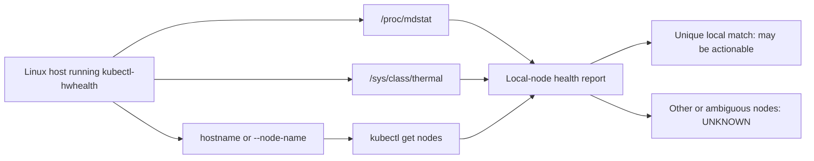

<p align="center">
  <a href="https://github.com/JemBuildz/kubectl-hwhealth/actions/workflows/release.yml"></a>
  <a href="https://github.com/JemBuildz/kubectl-hwhealth/releases/latest"></a>
  <a href="https://github.com/JemBuildz/kubectl-hwhealth/releases"></a>
  
  
  <a href="https://github.com/JemBuildz/kubectl-hwhealth"></a>
</p>

<p align="center"><strong>Local-first hardware health for Kubernetes nodes.</strong><br>
A small Go kubectl plugin for Linux software RAID and CPU thermal status—with node identity and safe failure handling built in.</p>

> [!IMPORTANT]
> **Run it on the Linux host whose hardware you want to inspect.** The plugin reads that host’s sensors; it is not a remote agent or cluster-wide telemetry system. Uninspected nodes remain `UNKNOWN` rather than inheriting another machine’s readings.

## Contents

- [Why kubectl-hwhealth](#why-kubectl-hwhealth)
- [How it works](#how-it-works)
- [Demo previews](#demo-previews)
- [Quick start](#quick-start)
- [Install and verify](#install-and-verify)
- [Commands and options](#commands-and-options)
- [Safety model](#safety-model)
- [Development](#development)
- [License](#license)

## Why kubectl-hwhealth

Kubernetes can report node readiness and workload status, but a standard Kubernetes node view does not expose Linux `mdraid` member state or host CPU thermal-zone readings. `kubectl-hwhealth` adds a focused, one-shot check for those signals on the Linux machine where it runs.

| Signal | What it checks | How missing or ambiguous data is handled |
|---|---|---|
| Software RAID | Parses `/proc/mdstat`, evaluates multiple `md*` arrays, and reports the most severe observed state | Unreadable or incomplete state is `UNKNOWN`, not assumed healthy |
| CPU thermals | Reads recognized CPU/package zones under `/sys/class/thermal` | Missing, unreadable, or invalid readings are `UNKNOWN`; ambient-only sensors are not substituted |
| Kubernetes node identity | Maps local readings to a uniquely matching node name or hostname label | Remote, unmatched, or ambiguous nodes are not actionable |

Highlights:

- Read-only scan by default; no background service or telemetry publishing.
- `--warn-temp` threshold is configurable (default: **75°C**).
- Simulation mode is always dry-run, even when remediation flags are supplied.
- Optional cordon, drain, and Slack/Discord alert paths are guarded by explicit context and node checks.
- Linux release binaries for **amd64** and **arm64**, with SHA-256 checksums and GitHub provenance attestations.

## How it works



By default, the plugin uses the host name and matches it against a Kubernetes node name or `kubernetes.io/hostname` label. If your host and node names differ, supply `--node-name`; with that override, the name must match a Kubernetes node exactly. Automated actions require exactly one local-node match. If the cluster cannot be queried or the match is not unique, the program fails closed and will not remediate.

For multi-node clusters, run the command on each Linux node you want to inspect. This release does not authenticate or consume remote hardware annotations.

## Demo previews

These are illustrative Canvas mockups made with the [Screenshot Studio](assets/demo/screenshot-studio.html). Node names, sensor readings, and RAID states are fictional sample data; the images are not live captures and no cluster or hardware was queried. The second preview shows the non-mutating `--simulate-raid-fail --auto-cordon` path.

<p align="center">
  <a href="assets/demo/read-only-scan-preview.png"></a>
  <a href="assets/demo/simulated-dry-run-preview.png"></a>
</p>

## Quick start

Run a read-only scan from the Linux node being checked:

```bash
kubectl hwhealth --context homelab --node-name k3s-worker-2
```

`--context` is optional for a read-only scan; it is shown here to make the target cluster explicit. If the local host name already matches the Kubernetes node name, `--node-name` can be omitted.

Safely exercise the failure path and preview a would-be action:

```bash
kubectl hwhealth \
  --context homelab \
  --node-name k3s-worker-2 \
  --simulate-raid-fail \
  --auto-cordon
```

Simulation makes no Kubernetes mutation and sends no webhook request. It is safe for demonstrating the action flow; it does not validate a production license.

## Install and verify

Download the current Linux binary from the [v0.2.0 release](https://github.com/JemBuildz/kubectl-hwhealth/releases/tag/v0.2.0). Select `amd64` or `arm64` for the Linux host:

```bash
set -euo pipefail
ARCH=amd64 # change to arm64 on a Linux ARM64 host
ASSET="kubectl-hwhealth-linux-${ARCH}"
BASE_URL="https://github.com/JemBuildz/kubectl-hwhealth/releases/latest/download"

curl -fsSLo "$ASSET" "$BASE_URL/$ASSET"
curl -fsSLo checksums.txt "$BASE_URL/checksums.txt"
grep -F "  $ASSET" checksums.txt | sha256sum -c -

gh attestation verify "$ASSET" \
  --repo JemBuildz/kubectl-hwhealth \
  --signer-workflow JemBuildz/kubectl-hwhealth/.github/workflows/release.yml

chmod +x "$ASSET"
sudo install -m 0755 "$ASSET" /usr/local/bin/kubectl-hwhealth
```

The checksum helps detect corruption; because it is distributed with the binary, it is not an independent publisher-authentication mechanism. The `gh attestation verify` step verifies GitHub build provenance for the expected repository and workflow. It requires GitHub CLI with attestation support.

See the [release page](https://github.com/JemBuildz/kubectl-hwhealth/releases) for assets, checksums, and provenance.

## Commands and options

| Option | Purpose |
|---|---|
| `--context NAME` | Selects the Kubernetes context. Required with `--auto-cordon`, `--auto-drain`, or `--webhook-url`. |
| `--node-name NAME` | Explicit Kubernetes node name for this host; when set, it must match exactly. |
| `--warn-temp CELSIUS` | CPU/package warning threshold; default `75`. Must be greater than 0 and less than 135. |
| `--simulate-raid-fail` | Simulates a degraded RAID finding. Any requested action remains dry-run. |
| `--auto-cordon` | Cordon the uniquely matched local node after a confirmed failure. |
| `--auto-drain` | Drain the uniquely matched local node after a confirmed failure. Cannot be combined with `--auto-cordon`. |
| `--webhook-url URL` | Send a failure alert to an approved Slack or Discord HTTPS webhook. |
| `--license-key KEY` | Provide a signed Pro key; alternatively set `HWHEALTH_LICENSE_KEY`. Required for live actions, not simulation. |

Run `kubectl hwhealth --help` for the CLI’s current flag descriptions.

## Safety model

**The default path is observational.** The command reads local hardware files and queries Kubernetes nodes; it does not patch nodes, evict pods, or send alerts unless an action is explicitly requested.

Before any live action, the program requires an explicit Kubernetes context, a uniquely matched local node, and a valid Ed25519-signed Pro key built against the configured public key. The key is a feature gate, not an authorization boundary—Kubernetes permissions still come from the active kubeconfig and RBAC identity. Use a dedicated identity with only the access required for the chosen operation.

- `--auto-cordon` prevents new pods from scheduling on the selected node; it does not evict existing pods.
- `--auto-drain` runs `kubectl drain --ignore-daemonsets --timeout=60s`. It does **not** pass `--delete-emptydir-data`; drain may fail when pods use local ephemeral data, leaving that decision to an operator.
- Webhooks are restricted to HTTPS Slack and Discord endpoints on port 443. Hostnames are allowlisted, DNS answers are checked for private/special-use addresses, redirects are disabled, and non-2xx responses fail the command.
- Missing sensor or RAID data is reported as unknown; unknown or ambiguous nodes are never treated as confirmed hardware failures.

The release workflow runs tests and `go vet` on pushes, pull requests, and release builds. Build/test jobs use read-only repository permissions; a separate publisher job receives release-write permissions to attach binaries and attestations.

## Development

Requires Go 1.23 or newer.

```bash
git clone https://github.com/JemBuildz/kubectl-hwhealth.git
cd kubectl-hwhealth
go test ./...
go vet ./...
go build .
```

Contributions and bug reports are welcome through [GitHub Issues](https://github.com/JemBuildz/kubectl-hwhealth/issues) and pull requests. Please include reproducible hardware/OS details for sensor or RAID parsing reports, and never include real webhook URLs or private license-signing keys in issues.

## License

There is currently no `LICENSE` file in the repository. Do not assume the code is available under an open-source license; ask the maintainer before reusing or redistributing it.
