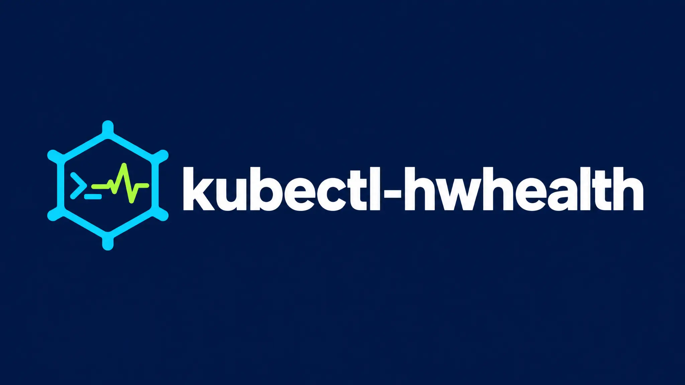
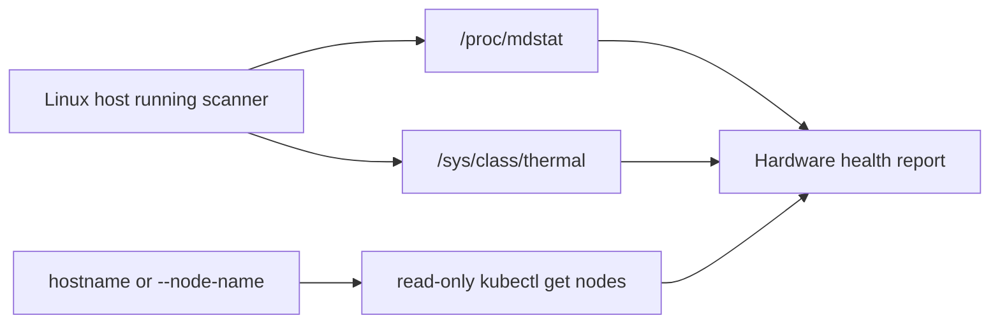
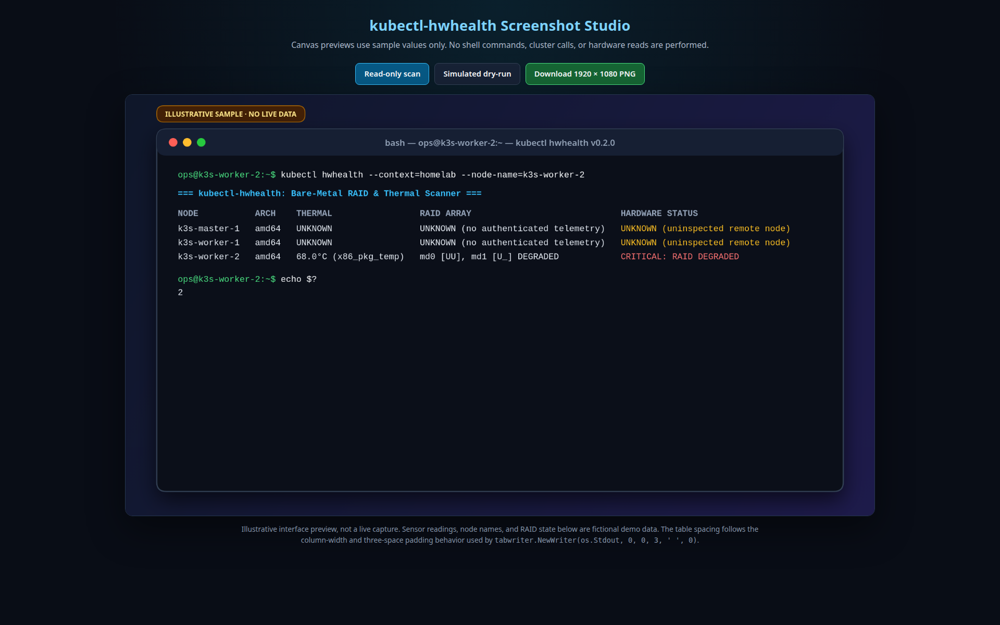
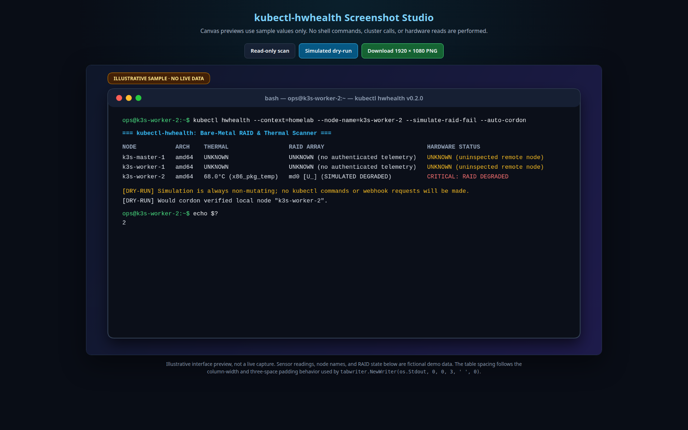

# kubectl-hwhealth: Kubernetes Node Hardware Health Scanner



<p align="center">
  <a href="https://github.com/JemBuildz/kubectl-hwhealth/actions/workflows/release.yml"></a>
  <a href="LICENSE"></a>
  
  
  <a href="https://github.com/JemBuildz/kubectl-hwhealth"></a>
</p>

<p align="center"><strong>Read-only, local-first hardware health for Kubernetes nodes.</strong><br>
A small Go scanner for Linux software RAID and CPU thermal status.</p>

> [!IMPORTANT]
> **The current `main` branch contains only the read-only scanner.** The existing `v0.2.0` tag and release predate this split and remain unchanged; they contain the earlier Pro-capable source and binaries. They are not builds of this scanner-only branch. No new scanner-only release is being published as part of this change, so build from the current source below.

## Contents

- [What it checks](#what-it-checks)
- [How it works](#how-it-works)
- [Demo previews](#demo-previews)
- [Build and run](#build-and-run)
- [Options and exit codes](#options-and-exit-codes)
- [Go package](#go-package)
- [Safety](#safety)
- [FAQ](#faq)
- [Development](#development)
- [License](#license)

## What it checks

Kubernetes reports node and workload state, but does not expose Linux `mdraid` member state or host CPU thermal-zone readings. Run this one-shot scanner on the Linux host whose hardware you want to inspect.

| Signal | Source | Missing or ambiguous data |
|---|---|---|
| Software RAID | `/proc/mdstat`; evaluates multiple `md*` arrays | Unreadable or incomplete state is `UNKNOWN`, not assumed healthy |
| CPU thermals | Recognized CPU/package zones under `/sys/class/thermal` | Missing, unreadable, invalid, or ambient-only readings are `UNKNOWN` |
| Node identity | Host name or `--node-name`, matched against Kubernetes node name/hostname label | Remote, unmatched, or ambiguous nodes remain `UNKNOWN` |

The warning threshold is configurable with `--warn-temp` (default **75°C**). Linux binaries are built for **amd64** and **arm64**; future tagged releases will include SHA-256 checksums and GitHub provenance attestations.

## How it works



By default, the scanner uses the host name and matches it against a Kubernetes node name or `kubernetes.io/hostname` label. If the host and node names differ, pass `--node-name`; an explicit name must match exactly. Local readings are associated with a Kubernetes node only when the identity match is unique. The scanner never treats another node's missing telemetry as healthy.

## Demo previews

These are illustrative Canvas mockups made with the [Screenshot Studio](assets/demo/screenshot-studio.html). The names and readings are fictional; the images are not live captures. The second image is a mockup of the separate commercial Pro product and **does not represent functionality in this public scanner**.

<p align="center">
  <a href="assets/demo/read-only-scan-preview.png"></a>
  <a href="assets/demo/simulated-dry-run-preview.png"></a>
</p>

## Build and run

There is not yet a scanner-only binary release. Build the current `main` branch with Go 1.23 or newer:

```bash
git clone https://github.com/JemBuildz/kubectl-hwhealth.git
cd kubectl-hwhealth
go test ./...
go build -o kubectl-hwhealth .
sudo install -m 0755 kubectl-hwhealth /usr/local/bin/kubectl-hwhealth
```

With `kubectl` configured for the intended cluster, run the plugin from the host being inspected:

```bash
kubectl hwhealth --context homelab --node-name worker-2
```

`--context` is optional and defaults to the current `kubectl` context. `--node-name` can be omitted when the host name matches the Kubernetes node identity.

To exercise the report path without relying on a degraded array, simulate a RAID finding:

```bash
kubectl hwhealth --simulate-raid-fail
```

This substitutes a simulated degraded RAID result in the local scan. It does not perform Kubernetes actions or send alerts.

## Options and exit codes

| Option | Purpose |
|---|---|
| `--context NAME` | Select the Kubernetes context for the read-only node query. |
| `--node-name NAME` | Explicit node name for this host; must match exactly when supplied. |
| `--warn-temp CELSIUS` | CPU/package warning threshold; default `75`; must be finite and between 0 and 135. |
| `--simulate-raid-fail` | Display a simulated degraded RAID finding; no action is performed. |
| `--help` | Show the scanner options. |

Exit code `0` means no critical finding was reported. Exit code `2` is used for a critical finding or invalid command-line input. A failed Kubernetes query is shown as a warning and the local host is still reported.

## Go package

The reusable read-only scanner is available at `github.com/jembuildz/kubectl-hwhealth/pkg/health`:

```go
result, err := health.Scan(ctx, health.Options{
    KubernetesContext: "homelab",
    NodeName:          "worker-2",
    WarnTempC:         80,
})
if err != nil {
    return err
}
for _, node := range result.Reports {
    fmt.Printf("%s: %s\n", node.Name, node.StatusDisplay)
}
```

`health.Scan` reads the local host's hardware files and may call only `kubectl get nodes -o json`. Its public API contains no node-remediation or webhook operations.

## Safety

This repository's current scanner-only code is observational: it reads local hardware files and issues a read-only Kubernetes node query. It contains no `cordon` or `drain` implementation, license-key gate, or webhook sender. A Kubernetes identity with permission to list nodes is sufficient for cluster association; no write permission is needed.

Commercial Pro remediation is maintained separately and is not part of the current public source tree or scanner-only binaries.

## Development

Requires Go 1.23 or newer.

```bash
go test ./...
go vet ./...
go build .
```

The release workflow runs tests and `go vet` on pushes and pull requests. Future published scanner-only releases build Linux amd64/arm64 binaries, checksums, and provenance attestations.

## FAQ

### What hardware does kubectl-hwhealth check?

It reads Linux software RAID status from `/proc/mdstat` and CPU/package thermal readings from recognized zones under `/sys/class/thermal` on the host where the command runs.

### Is the public scanner read-only?

Yes. The current public `main` reads local hardware files and may run `kubectl get nodes -o json` to associate local readings with a node. It does not cordon or drain nodes, change Kubernetes resources, or send webhook requests.

### Does it collect hardware telemetry from every node remotely?

No. Run it on each Linux host whose hardware you want to inspect. The Kubernetes node list is used for identity matching only; uninspected, unmatched, or ambiguous nodes remain `UNKNOWN`.

### What Kubernetes permissions are required?

For node association, the active Kubernetes identity needs permission to list nodes. The public scanner requires no write permissions. If the `kubectl` query fails, it still reports the local host and indicates that cluster association was unavailable.

### Which operating systems and CPU architectures are supported?

The scanner is intended to run on Linux and the release workflow builds Linux `amd64` and `arm64` binaries. Building from source requires Go 1.23 or newer.

### How do I install the current scanner-only version?

There is not yet a scanner-only binary release; build from the current `main` branch using [Build and run](#build-and-run). The `v0.2.0` release predates the split and is not a build of the current scanner-only source.

### What does `--simulate-raid-fail` do?

It substitutes a simulated degraded RAID result so you can preview scanner output. It performs no Kubernetes action and sends no alert.

### Are Pro remediation features included in this repository?

No. The current public source and scanner package contain only read-only diagnostics. Commercial Pro remediation is maintained separately.

### Can I call the scanner from another Go program?

Yes. Import `github.com/jembuildz/kubectl-hwhealth/pkg/health` and call `health.Scan`; see the [Go package example](#go-package).

## License

The scanner-only source in the current public branch is licensed under the MIT License; see [`LICENSE`](LICENSE). The historical `v0.2.0` tag and release predate the split and are not covered by the license added to this scanner-only snapshot. That tag and release have been left unchanged.
