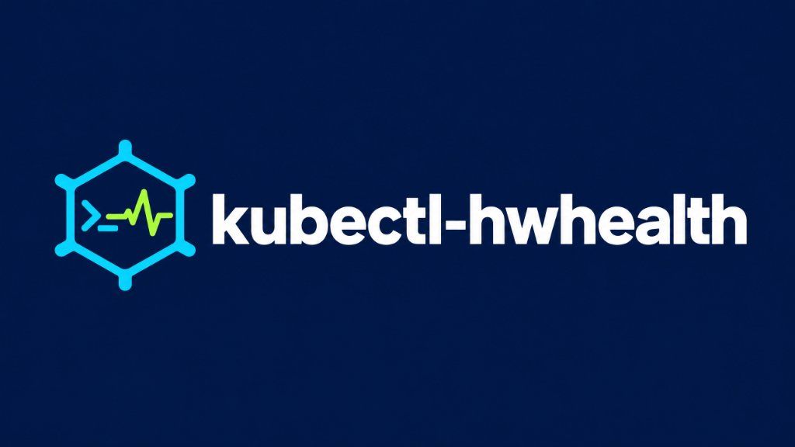

<p align="center">
  
</p>

**Catch failing bare-metal RAID drives and overheating nodes before Kubernetes loses your data.**

Standard Kubernetes (`kubelet`) schedules workloads based on CPU and RAM requests. It has no built-in awareness when a Linux software RAID array (`mdadm`) drops a member drive into degraded `[U_]` state or a bare-metal node begins thermally throttling.

`kubectl-hwhealth` is a zero-dependency Go plugin that inspects Linux software RAID status (`/proc/mdstat` across single or multiple `md*` arrays) and CPU/package thermal sensors (`/sys/class/thermal`), binds readings strictly to verified node identities, and optionally cordons or drains failing hardware.

---

## ⚡ Install & Verify Checksum (Free CLI)

Download the pre-compiled binary and verify its SHA-256 checksum from [Releases](../../releases/latest):

```bash
curl -fsSLO https://github.com/JemBuildz/kubectl-hwhealth/releases/latest/download/kubectl-hwhealth-linux-amd64
curl -fsSLO https://github.com/JemBuildz/kubectl-hwhealth/releases/latest/download/checksums.txt
grep kubectl-hwhealth-linux-amd64 checksums.txt | sha256sum -c -

chmod +x kubectl-hwhealth-linux-amd64
sudo mv kubectl-hwhealth-linux-amd64 /usr/local/bin/kubectl-hwhealth
```

Run a local hardware check:

```bash
kubectl hwhealth
```

---

## 🏗️ Verified Node Telemetry Binding & Signed Annotations

To prevent local host sensors or stale/spoofed annotations from ever cordoning the wrong Kubernetes node:

1. **Local Node Matching:** `/proc/mdstat` and `/sys/class/thermal` read on the current machine are bound **only** to the Kubernetes node matching `os.Hostname()` (or `--node-name=<name>`).
2. **Signed & Fresh Multi-Node Telemetry (`--publish-node-status`):** On multi-node clusters, each worker node runs `kubectl hwhealth --publish-node-status --node-signing-key=<ed25519-priv-hex>`, which signs the canonical telemetry payload (`node|raidState|raidSummary|cpuTemp|updatedAt`) with Ed25519. When aggregating cluster status, remote node annotations are only trusted if:
   * `hwhealth.io/updated-at` is within `--annotation-max-age` (default `5m`), and
   * `hwhealth.io/signature` passes `crypto/ed25519` verification against `--node-verify-pubkey` (`HWHEALTH_NODE_VERIFY_PUBKEY`).
   Uninspected, expired, or unsigned remote nodes report `UNKNOWN` and are never cordoned or drained.

```text
=== kubectl-hwhealth v0.2.0: Bare-Metal RAID & Thermal Scanner ===

NODE           ARCH    THERMAL                RAID ARRAY               HARDWARE STATUS
k3s-master-1   amd64   46.0°C (x86_pkg_temp)  md0 [UU]                 HEALTHY
k3s-worker-2   amd64   81.5°C (x86_pkg_temp)  md0 [U_] DEGRADED        CRITICAL: RAID DEGRADED
k3s-worker-3   arm64   UNKNOWN                UNKNOWN                  UNKNOWN (uninspected remote node)
```

---

## 🧪 Isolated Failure Simulation (Always Dry-Run)

Preview how `kubectl-hwhealth` detects a degraded array without mutating your cluster. `--simulate-raid-fail` is hard-isolated: it cannot be combined with `--publish-node-status` and always runs in dry-run mode (even if paired with a production license key):

```bash
kubectl hwhealth --simulate-raid-fail --auto-cordon --license-key=PRO-DEMO-2026
```

---

## 💼 Community (Free) vs. Pro Edition

* **Community Edition (Free Forever):**
  * Multi-array `/proc/mdstat` RAID health inspection (`[UU]`, `[U_]`, and `resync`/`recovery` state aggregation)
  * CPU/package thermal zone scanning (`/sys/class/thermal`)
  * Ed25519-signed node telemetry publishing (`--publish-node-status`)
* **Pro Edition ($79 Lifetime License):**
  * **Automated Safe Cordoning (`--auto-cordon`):** Marks verified failing nodes unschedulable (`kubectl cordon`) so no new pods land on degraded hardware.
  * **Automated Workload Draining (`--auto-drain`):** Evicts pods gracefully (`kubectl drain --ignore-daemonsets --delete-emptydir-data --timeout=60s`) while respecting `PodDisruptionBudgets`.
  * **Hardened Slack & Discord HTTPS Webhooks (`--webhook-url`):** Dual-format HTTPS alerts with status-code verification.

### Security & Kubernetes RBAC Scope
The license token (`HWPRO1.<CustomerID>.<Ed25519Signature>`) is verified offline using `crypto/ed25519` against the public key injected at build time (`main.ed25519PubKeyHex`). Cluster authorization is enforced strictly by Kubernetes RBAC. Scope unattended node agents to `get`, `list`, and `patch` on `nodes`.

👉 **[Get an Instant Pro License Key Here](#)**
